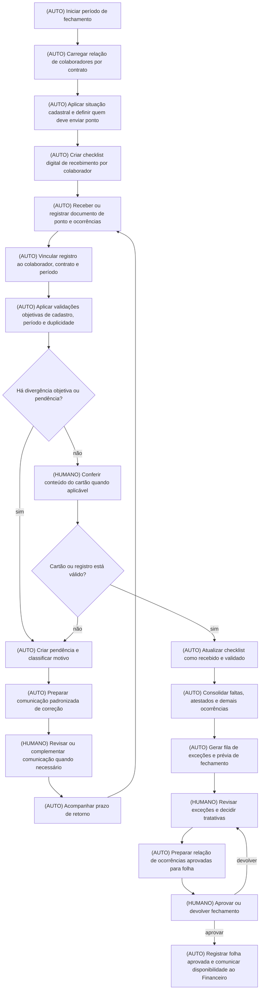

# Escopo do Plano — Otimização da Coleta, Conferência e Auditoria de Ponto

## 1\. Cabeçalho

- **Empresa:** WSO Serviços Especializados Ltda.  
- **Processo master:** Gestão de Recursos Humanos / Departamento Pessoal — coleta, conferência, auditoria de ponto e fechamento da folha  
- **Vídeos-fonte:**  
  - `WhatsApp Video 2026-08-27 at 15.13.02.mp4` / `video_0.mp4` — Raio-X Individual  
- **Arquivos de contexto usados:**  
  - Contexto do cliente fornecido nesta solicitação, incluindo diagnóstico DMO  
  - `WSO.pdf`: **não utilizado como fonte de regras ou escopo**, pois seu conteúdo se refere explicitamente a uma empresa ABC Ltda. e a um projeto de logística/WMS, sem aderência ao processo de ponto da WSO.  
  - `[WSO] Mapeamento de processos .pdf`: não lido; conteúdo não utilizado.  
  - `wso overview.pdf`: não lido; conteúdo não utilizado.  
- **Data:** 27/08/2026

---

## 2\. Objetivo do sistema

A WSO opera com aproximadamente 5 mil colaboradores distribuídos em mais de 4 mil localidades, o que torna a coleta e o fechamento de ponto uma atividade administrativa de alta escala e risco. Hoje, parte relevante dos cartões de ponto chega como imagem por WhatsApp, é conferida manualmente em múltiplas ferramentas, comparada a planilhas e relatórios impressos, salva com renomeação manual e, posteriormente, lançada no sistema Domínio.

O gargalo consolidado é a **dependência de tratamento individual e descentralizado de cada cartão de ponto**, desde a recepção via chat até a conferência, controle de recebimento, solicitação de correções e lançamento de ocorrências na folha. Esse fluxo aumenta o tempo de fechamento, cria duplicidade de trabalho, dificulta a rastreabilidade e expõe a empresa a erros financeiros e trabalhistas.

O objetivo é entregar um sistema de **centralização, controle e auditoria determinística do ponto**, capaz de organizar a base de colaboradores esperados, controlar o recebimento dos documentos ou registros de ponto, aplicar validações objetivas, concentrar divergências para análise humana e preparar os dados de ocorrências para o fechamento da folha.

O sistema será utilizado principalmente por:

- Assistentes de RH e Departamento Pessoal;  
- Gestores e Gerência de RH;  
- Supervisão operacional, quando responsável por apoiar pendências de ponto;  
- Financeiro, como área recebedora da folha aprovada;  
- Diretoria e responsáveis por contratos, para acompanhamento gerencial de pendências e riscos.

### 2.1 Resumo da entrega

Será entregue um sistema de gestão do ciclo de ponto e pré-fechamento da folha. Ele centralizará a lista de colaboradores esperados por contrato, o acompanhamento de recebimento, as pendências, as ocorrências apuradas e a aprovação gerencial. O RH deixará de controlar o processo em relatório impresso, chats dispersos e planilhas paralelas, passando a trabalhar por filas, status e exceções organizadas.

---

## 3\. Visão geral do fluxo reformado

### Resumo do redesenho

| Situação atual | Rota no processo reformado | Justificativa |
| :---- | :---- | :---- |
| Impressão de relatório de empregados e baixa com marca-texto | **ELIMINAR** | É controle paralelo físico, sem ganho de qualidade ou rastreabilidade. O sistema passa a manter o status de recebimento digitalmente. |
| Filtrar chats por contrato e procurar manualmente cada colaborador | **AUTOMAÇÃO DETERMINÍSTICA** | A fila pode ser organizada por contrato, matrícula, situação e status de pendência com regras objetivas. |
| Conferir simultaneamente BotNext, relatório Domínio, planilha e papel | **AUTOMAÇÃO DETERMINÍSTICA** | O sistema consolida, para cada colaborador, os dados já existentes e apresenta uma visão única de acompanhamento. |
| Verificar se colaborador está ativo, demitido, em férias ou afastado | **AUTOMAÇÃO DETERMINÍSTICA** | A situação cadastral define, por regra, se o colaborador deve ou não constar como pendente de ponto. |
| Download, renomeação e organização manual de imagem | **AUTOMAÇÃO DETERMINÍSTICA** | Quando houver recebimento digital autorizado, o sistema deve vincular o arquivo ao colaborador e ao período, evitando nomeação e organização manual. |
| Identificação de cartão incompleto ou ilegível | **MANTER HUMANO** | A interpretação de cartões manuscritos e a avaliação de rasuras exigem julgamento. O sistema organiza a fila e registra a decisão. |
| Solicitar correção ao colaborador | **AUTOMAÇÃO DETERMINÍSTICA**, com confirmação humana quando necessário | Mensagens padronizadas podem ser disparadas a partir de motivo previamente selecionado; casos não padronizados permanecem sob redação humana. |
| Lançar faltas, atestados e descontos um a um no Domínio | **AUTOMAÇÃO DETERMINÍSTICA**, condicionada à validação do meio aceito pelo Domínio | O sistema prepara uma relação estruturada e auditável de ocorrências aprovadas. A forma de transferência ao Domínio precisa ser confirmada. |
| Revisão final da folha pela Gerência de RH | **MANTER HUMANO** | A aprovação da folha envolve responsabilidade gerencial e alçada de decisão. O sistema deve registrar aprovação, devolução e justificativa. |
| Comunicação de folha aprovada ao Financeiro | **AUTOMAÇÃO DETERMINÍSTICA** | Após aprovação gerencial, o sistema pode gerar a sinalização formal de folha pronta para a etapa financeira. |

&nbsp;

### Fluxo to-be do escopo base

&nbsp;

---

## 4\. Funcionalidades

### 4.1 Cadastro operacional de período, contrato e colaboradores esperados

- **O que faz:** cria a relação de colaboradores que devem ser acompanhados em cada período de fechamento, organizada por contrato, centro de custo e situação cadastral disponível.  
- **Para quem:** Assistente de RH e Gerência de RH.  
- **Dor resolvida:** elimina a necessidade de gerar, imprimir e marcar relatórios de empregados para controlar quem enviou ponto.  
- **Fonte:** vídeo `video_0.mp4`, 02:15 a 05:09.  
- **Rota:** automação determinística.

### 4.2 Checklist digital de recebimento de ponto

- **O que faz:** apresenta a lista de colaboradores esperados e seu status no ciclo: aguardando recebimento, recebido, em conferência, pendente de correção, validado, dispensado ou fora do escopo.  
- **Para quem:** Assistente de RH, Supervisão e Gerência de RH.  
- **Dor resolvida:** substitui o relatório impresso e a baixa manual com marca-texto.  
- **Fonte:** vídeo `video_0.mp4`, 04:42 e 09:55.  
- **Rota:** automação determinística.

### 4.3 Central de documentos e registros de ponto

- **O que faz:** permite vincular o cartão de ponto recebido ou registrar a existência de um ponto digital para o colaborador, contrato e período correspondentes.  
- **Para quem:** Assistente de RH.  
- **Dor resolvida:** reduz a dispersão entre chat, pastas locais e Google Drive.  
- **Fonte:** vídeo `video_0.mp4`, 06:11, 08:45 e 12:21.  
- **Rota:** automação determinística.

> Observação: o canal exato de recebimento e a possibilidade de trazer arquivos do BotNext ou de outro canal para o sistema dependem de validação com o cliente. O escopo base contempla o controle centralizado do recebimento; o meio de entrada deverá respeitar os canais autorizados pela WSO.

### 4.4 Identificação determinística de duplicidade

- **O que faz:** sinaliza mais de um envio associado ao mesmo colaborador e período, preservando rastreabilidade dos registros recebidos e indicando qual deve ser considerado no processo.  
- **Para quem:** Assistente de RH.  
- **Dor resolvida:** evita que a equipe salve e processe duas vezes a mesma folha enviada em números distintos de WhatsApp.  
- **Fonte:** vídeo `video_0.mp4`, 10:40 a 10:45.  
- **Rota:** automação determinística.

### 4.5 Fila de pendências e divergências

- **O que faz:** reúne os casos que exigem ação: ausência de documento, marcação incompleta, colaborador não localizado, duplicidade, inconsistência de cadastro e ocorrência pendente de decisão.  
- **Para quem:** Assistente de RH, Supervisão e Gerência de RH.  
- **Dor resolvida:** reduz a necessidade de procurar manualmente conversas e reabrir planilhas para identificar pendências.  
- **Fonte:** vídeo `video_0.mp4`, 11:07 a 11:48.  
- **Rota:** automação determinística e apoio a etapa humana.

### 4.6 Comunicação padronizada de recebimento e solicitação de correção

- **O que faz:** disponibiliza mensagens padronizadas para confirmação de recebimento, aviso de prazo e solicitação de ajuste, com base em motivos de pendência previamente cadastrados.  
- **Para quem:** Assistente de RH.  
- **Dor resolvida:** reduz digitação repetitiva e padroniza a comunicação com colaboradores.  
- **Fonte:** vídeo `video_0.mp4`, 10:19, 11:36 a 11:48 e 14:29.  
- **Rota:** automação determinística, com apoio humano em casos fora do padrão.

### 4.7 Registro e consolidação de ocorrências para folha

- **O que faz:** consolida, por colaborador e período, ocorrências já utilizadas no processo atual, como faltas, atestados, licenças, saídas antecipadas, afastamentos e descontos.  
- **Para quem:** Assistente de RH e Gerência de RH.  
- **Dor resolvida:** reduz dependência de planilhas dispersas e digitação repetitiva no fechamento.  
- **Fonte:** vídeo `video_0.mp4`, 06:27 e 15:36.  
- **Rota:** automação determinística, com validação humana das ocorrências que exigirem interpretação.

### 4.8 Prévia de fechamento e aprovação gerencial

- **O que faz:** apresenta o consolidado do período, as pendências abertas, os colaboradores dispensados do envio e as ocorrências aprovadas, permitindo que a Gerência aprove ou devolva o fechamento.  
- **Para quem:** Gerente de RH.  
- **Dor resolvida:** formaliza uma etapa atualmente citada, mas não demonstrada, e cria rastreabilidade da decisão.  
- **Fonte:** vídeo `video_0.mp4`, 16:19 a 17:08.  
- **Rota:** apoio a etapa humana.

### 4.9 Comunicação de folha aprovada para o Financeiro

- **O que faz:** registra que a folha foi aprovada e gera a comunicação de disponibilidade ao Financeiro, com identificação do período e responsável pela aprovação.  
- **Para quem:** Gerência de RH e Financeiro.  
- **Dor resolvida:** reduz dependência de comunicação informal para transferência de responsabilidade entre RH e Financeiro.  
- **Fonte:** vídeo `video_0.mp4`, 17:08.  
- **Rota:** automação determinística.

---

## 5\. Regras de negócio

### Regras atuais observadas

1. **\[REGRA ATUAL OBSERVADA\]** A gestão de colaboradores é organizada por contrato, centro de custo e localização geográfica.

   - **Fonte:** vídeo `video_0.mp4`, 02:15 a 03:36.  
2. **\[REGRA ATUAL OBSERVADA\]** Colaboradores demitidos devem ser removidos da relação de conferência de ponto.

   - **Fonte:** vídeo `video_0.mp4`, 02:50 a 03:20.  
3. **\[REGRA ATUAL OBSERVADA\]** Colaborador em férias ou afastamento identificado pela situação cadastral não deve ser cobrado pelo envio de cartão de ponto no período.

   - **Fonte:** vídeo `video_0.mp4`, 04:20.  
4. **\[REGRA ATUAL OBSERVADA\]** O cadastro no BotNext utiliza o padrão de identificação composto por nome completo e matrícula.

   - **Fonte:** vídeo `video_0.mp4`, 05:25.  
5. **\[REGRA ATUAL OBSERVADA\]** No processo atual, a imagem da folha ponto é salva seguindo o padrão de contrato, código da agência e nome completo do funcionário.

   - **Fonte:** vídeo `video_0.mp4`, 08:45 a 09:20.  
6. **\[REGRA ATUAL OBSERVADA\]** Para funcionários volantes, é utilizado o código genérico `5000` no local/código de agência.

   - **Fonte:** vídeo `video_0.mp4`, 09:20.  
7. **\[REGRA ATUAL OBSERVADA\]** Caso o colaborador envie a folha para mais de um número corporativo, o arquivo deve ser considerado uma única vez para evitar duplicidade.

   - **Fonte:** vídeo `video_0.mp4`, 10:40 a 10:45.  
8. **\[REGRA ATUAL OBSERVADA\]** Cartões com horários de entrada ou saída em branco devem retornar ao colaborador para correção e reenvio.

   - **Fonte:** vídeo `video_0.mp4`, 11:31 a 11:48.  
9. **\[REGRA ATUAL OBSERVADA\]** O período oficial da folha vai do dia 26 do mês anterior ao dia 25 do mês atual; contudo, a equipe estende a conferência até o dia 30 para reduzir pendências acumuladas.

   - **Fonte:** vídeo `video_0.mp4`, 15:50.  
10. **\[REGRA ATUAL OBSERVADA\]** A folha deve ser revisada e validada pela Gerência de RH antes da liberação para o Financeiro.

    - **Fonte:** vídeo `video_0.mp4`, 16:50 a 17:08.

### Regras propostas para o sistema reformado

1. **\[PROPOSTA\]** Cada colaborador deverá ter um único status de acompanhamento por período de folha, ainda que existam múltiplos envios ou múltiplos canais de comunicação.

2. **\[PROPOSTA\]** O sistema deverá manter o histórico de todos os envios e decisões, mas somente um documento ou registro poderá ser marcado como versão válida para o fechamento.

3. **\[PROPOSTA\]** Somente colaboradores com situação elegível para apontamento deverão entrar automaticamente na fila de pendência de ponto.

4. **\[PROPOSTA\]** Pendências deverão possuir motivo padronizado, responsável atual, data de criação, prazo de retorno e histórico de tratativas.

5. **\[PROPOSTA\]** Ocorrências só poderão compor a relação de fechamento após registro de validação pelo responsável definido pela WSO.

6. **\[PROPOSTA\]** A aprovação gerencial deverá registrar responsável, data, decisão e justificativa quando houver devolução do fechamento.

7. **\[PROPOSTA\]** Após aprovação gerencial, alterações nas ocorrências do período deverão ser tratadas como reabertura formal do fechamento, com registro de motivo e novo ciclo de aprovação.

---

## 6\. Automações

### 6.1 Formação da lista digital de conferência

- **Gatilho:** abertura de um novo período de fechamento.  
- **Regra:** considerar contrato, centro de custo, matrícula e situação cadastral dos colaboradores.  
- **Resultado:** geração de checklist digital de colaboradores esperados, dispensados e pendentes.  
- **Antes:** geração de relatório no Domínio, remoção manual de demitidos, impressão e marcação em papel.  
- **Ganho esperado:** eliminação do controle impresso e visão única do andamento por contrato.

### 6.2 Atualização automática do status de recebimento

- **Gatilho:** registro ou vinculação de um cartão/documento ao colaborador e período.  
- **Regra:** identificar matrícula ou associação manual validada pelo RH; verificar contrato e período correspondente.  
- **Resultado:** atualização do status para recebido ou em conferência.  
- **Antes:** baixa física com marca-texto no relatório impresso.  
- **Ganho esperado:** rastreabilidade em tempo real e eliminação de controles paralelos.

### 6.3 Detecção de duplicidade

- **Gatilho:** entrada de novo documento ou registro para colaborador já atendido no mesmo período.  
- **Regra:** comparar colaborador, período e status existente.  
- **Resultado:** criação de alerta de duplicidade, sem duplicar a baixa ou a ocorrência.  
- **Antes:** o RH precisava perceber manualmente que o colaborador enviara para mais de um número.  
- **Ganho esperado:** redução de retrabalho e risco de considerar o mesmo documento duas vezes.

### 6.4 Criação de pendência por motivo padronizado

- **Gatilho:** identificação de cartão incompleto, ausência de documento, dado cadastral divergente ou outra condição definida pela WSO.  
- **Regra:** classificar a pendência conforme catálogo de motivos aprovado pelo RH.  
- **Resultado:** caso direcionado à fila adequada, com prazo e responsável.  
- **Antes:** o RH mantinha a conversa aberta no BotNext e dependia da memória ou de controles paralelos.  
- **Ganho esperado:** redução de esquecimento, priorização de pendências críticas e acompanhamento gerencial.

### 6.5 Preparação de comunicação padronizada

- **Gatilho:** criação de pendência por motivo conhecido.  
- **Regra:** associar o motivo de pendência a uma mensagem padrão aprovada.  
- **Resultado:** texto pronto para confirmação de recebimento, solicitação de correção ou lembrete de prazo.  
- **Antes:** redação manual repetitiva de mensagens em chat.  
- **Ganho esperado:** rapidez, padronização e redução de variação na comunicação.

### 6.6 Consolidação de ocorrências para pré-fechamento

- **Gatilho:** encerramento da conferência ou solicitação de prévia de fechamento.  
- **Regra:** agrupar as ocorrências registradas e aprovadas por colaborador, contrato e período.  
- **Resultado:** relação de faltas, atestados, licenças, afastamentos, saídas antecipadas e descontos a serem tratados na folha.  
- **Antes:** consulta à planilha e lançamento individual no Domínio.  
- **Ganho esperado:** redução de redigitação e melhoria na auditabilidade.

### 6.7 Sinalização de folha aprovada

- **Gatilho:** aprovação da Gerência de RH.  
- **Regra:** somente fechamento sem pendência bloqueadora poderá seguir para status aprovado, conforme critérios a validar.  
- **Resultado:** registro de aprovação e comunicação de disponibilidade para o Financeiro.  
- **Antes:** envio informal do extrato e comunicação entre áreas.  
- **Ganho esperado:** clareza de responsabilidade e histórico de liberação.

---

## 7\. Fluxos do usuário

### 7.1 Assistente de RH

1. Acessa o painel do período de fechamento.  
2. Seleciona contrato, centro de custo ou grupo de colaboradores sob sua responsabilidade.  
3. Visualiza quantos colaboradores estão aguardando envio, em conferência, com pendência, validados ou dispensados.  
4. Abre o cadastro operacional do colaborador.  
5. Consulta os dados disponíveis no processo: matrícula, nome, contrato, situação e histórico de documentos ou ocorrências.  
6. Registra ou vincula o documento de ponto recebido.  
7. Marca o resultado da conferência: válido, pendente de correção, duplicado, ilegível ou outro motivo aprovado.  
8. Quando necessário, seleciona o motivo da pendência e utiliza uma comunicação padronizada.  
9. Registra faltas, atestados, licenças, afastamentos ou demais ocorrências aplicáveis.  
10. Acompanha a fila de pendências até que os casos estejam resolvidos ou escalados.

### 7.2 Supervisão operacional

1. Acessa a lista de pendências sob sua área, contrato ou localidade, conforme regra de acesso definida.  
2. Visualiza quais colaboradores precisam regularizar ponto ou fornecer informação adicional.  
3. Apoia a obtenção de correções junto ao colaborador ou posto.  
4. Registra retorno, justificativa ou evidência recebida.  
5. Encaminha o caso ao RH quando a tratativa exigir decisão trabalhista, documental ou de folha.

### 7.3 Gerência de RH

1. Acessa a visão consolidada do período de fechamento.  
2. Analisa quantidade e criticidade das pendências por contrato, localidade e responsável.  
3. Consulta ocorrências que foram preparadas para compor a folha.  
4. Avalia exceções que exigem decisão ou alçada.  
5. Aprova o fechamento ou devolve para correção, registrando justificativa.  
6. Após aprovação, acompanha o status de comunicação ao Financeiro.

### 7.4 Financeiro

1. Recebe a sinalização de que a folha está aprovada.  
2. Consulta o período, data da aprovação e responsável aprovador.  
3. Utiliza a informação para seguir com o processo financeiro de pagamento, que está fora deste escopo.  
4. Registra o recebimento da liberação, caso a WSO defina essa etapa como necessária.

---

## 8\. Dados e informações necessárias

| Informação | Origem | Uso no sistema |
| :---- | :---- | :---- |
| Matrícula | Cadastro de empregados / Domínio | Identificação do colaborador e prevenção de duplicidade |
| Nome completo | Cadastro de empregados / Domínio | Identificação do colaborador |
| Contrato | Cadastro de empregados / Domínio | Organização das filas e acompanhamento por contrato |
| Centro de custo | Cadastro de empregados / Domínio | Segmentação da conferência e do fechamento |
| Função | Cadastro de empregados / Domínio | Contexto de conferência e gestão |
| Carga horária | Cadastro de empregados / Domínio | Referência operacional para auditoria, conforme regra a validar |
| Data de admissão | Cadastro de empregados / Domínio | Contexto cadastral |
| Situação do empregado | Cadastro de empregados / Domínio | Definição de elegibilidade para envio de ponto |
| Código de situação | Cadastro de empregados / Domínio | Identificação de ativo, férias e demais situações |
| CPF | Cadastro de empregados / Domínio | Dado citado no relatório; necessidade de exibição deverá ser validada por minimização de acesso |
| Período de folha | Regra operacional vigente | Organização do ciclo de conferência |
| Data de recebimento | Calculado pelo sistema no momento do registro | Controle de prazo e histórico |
| Documento de ponto ou referência ao ponto digital | Recebimento do colaborador, RH ou sistema de ponto autorizado | Evidência de conferência |
| Status do ponto | Calculado e atualizado pelo sistema | Gestão do checklist digital |
| Motivo da pendência | Seleção pelo RH em lista padronizada | Priorização e comunicação |
| Histórico de comunicações | Registro do RH ou canal autorizado | Auditoria da tratativa |
| Faltas | Planilha atual, ponto ou registro do RH | Consolidação para folha |
| Atestados médicos | Planilha atual, documento ou registro do RH | Consolidação para folha |
| Licenças | Planilha atual ou registro do RH | Consolidação para folha |
| Saídas antecipadas | Planilha atual, cartão de ponto ou registro do RH | Consolidação para folha |
| Afastamentos | Cadastro ou registro do RH | Definição de elegibilidade e tratamento de folha |
| Descontos | Registro de ocorrência aprovado | Preparação para fechamento |
| Responsável pela validação | Input do RH ou calculado por regra de atribuição | Rastreabilidade |
| Aprovação gerencial | Input da Gerência de RH | Liberação do fechamento |
| Data e justificativa de devolução | Input da Gerência de RH | Auditoria do ciclo de aprovação |

&nbsp;

---

## 9\. Evoluções sugeridas com IA (opcional — fora do escopo base)

O sistema descrito neste escopo funciona integralmente sem IA. As evoluções abaixo não são pré-requisito para a implantação do fluxo determinístico.

### 9.1 Leitura assistida de cartões de ponto manuscritos

- **Etapa de origem:** conferência de imagens de cartões físicos enviados por WhatsApp.  
- **Tipo:** IA generativa pontual.  
- **O que poderia fazer:** sugerir extração de datas, horários, campos em branco e possíveis inconsistências visuais a partir de imagem de cartão de ponto.  
- **Ganho potencial:** redução do tempo de triagem visual e priorização de cartões aparentemente incompletos.  
- **Trade-offs:** custo por processamento, menor previsibilidade na leitura de manuscritos, risco de interpretação incorreta e necessidade obrigatória de validação humana antes de qualquer impacto na folha.  
- **Limite:** a IA não deve aprovar ponto, lançar desconto ou decidir ocorrência trabalhista. Sua saída deve ser apenas uma sugestão para conferência.

### 9.2 Classificação de mensagens recebidas em canais de atendimento

- **Etapa de origem:** recepção de mensagens e documentos por WhatsApp.  
- **Tipo:** IA generativa pontual.  
- **O que poderia fazer:** sugerir classificação de mensagens como envio de ponto, justificativa, atestado, dúvida, correção ou outro assunto.  
- **Ganho potencial:** redução da triagem inicial em alto volume.  
- **Trade-offs:** custo por execução, possibilidade de classificação incorreta e necessidade de amostragem e supervisão operacional.  
- **Limite:** a classificação não deve alterar dados de folha nem concluir atendimentos sem confirmação humana.

### 9.3 Assistente de análise de pendências recorrentes

- **Etapa de origem:** acompanhamento das filas de pendência por contrato, localidade e motivo.  
- **Tipo:** IA generativa pontual.  
- **O que poderia fazer:** resumir padrões de pendências recorrentes, como postos com alta incidência de cartões incompletos ou atrasos de envio.  
- **Ganho potencial:** apoio à gestão preventiva e identificação mais rápida de locais prioritários.  
- **Trade-offs:** as conclusões devem ser tratadas como apoio analítico, não como decisão automática; requer supervisão do RH e da operação.

Não se recomenda, neste momento, um agente de IA que decida tratativas de ponto ou execute ações autônomas sobre a folha. A natureza trabalhista e financeira do processo exige regras auditáveis, alçadas explícitas e validação humana.

---

## 10\. Sugestões estratégicas e alternativas (fora do sistema)

### 10.1 Priorizar migração gradual de cartões manuscritos para ponto digital

**Cadeia de porquês**

1. O fechamento demora porque o RH analisa cartões individualmente.  
2. O RH analisa cartão por cartão porque a evidência chega como foto em chat.  
3. A foto precisa de interpretação porque o cartão é preenchido manualmente.  
4. O preenchimento manual gera horários ausentes, rasuras e necessidade de reenvio.  
5. A condição de negócio que mantém a dor parece ser a existência de postos ou contratos que ainda dependem de cartão físico.

**O que muda:** criar plano de priorização para migração dos contratos com maior volume de retrabalho para ponto digital, considerando a alternativa já citada de `Ponto Mais`.

**Benefício esperado:** redução estrutural de fotos, arquivos, conferência visual e solicitações de correção.

**O que validar:**

- \[HIPÓTESE\] Existem restrições contratuais, sindicais, operacionais ou de conectividade que impedem a adoção ampla de ponto digital.  
- \[HIPÓTESE\] Os contratos com maior volume de colaboradores também concentram maior incidência de cartões físicos e pendências.  
- \[HIPÓTESE\] O `Ponto Mais` atende aos requisitos trabalhistas, operacionais e de auditoria necessários para os contratos da WSO.

### 10.2 Definir um canal corporativo único para recebimento de ponto

**Cadeia de porquês**

1. Há duplicidade porque colaboradores enviam documentos para mais de um número.  
2. Enviam para mais de um número porque existem múltiplos canais ativos.  
3. Existem múltiplos canais porque a comunicação parece estar distribuída por contratos, equipes ou rotinas históricas.  
4. A distribuição de canais dificulta definir qual envio é oficial.  
5. A condição de negócio pode ser a ausência de uma política operacional única de canal oficial e prazo de envio.

**O que muda:** estabelecer, por contrato ou grupo de colaboradores, um canal oficial de recebimento, uma mensagem de orientação e uma política clara de exceção.

**Benefício esperado:** menos duplicidades, menor volume de atendimento e maior rastreabilidade.

**O que validar:**

- \[HIPÓTESE\] É possível consolidar os canais atuais sem prejudicar a operação dos contratos.  
- \[HIPÓTESE\] Alguns clientes, localidades ou contratos exigem canais específicos de comunicação.  
- \[HIPÓTESE\] O BotNext pode atender ao canal único desejado ou será necessário manter outro meio oficial.

### 10.3 Rever a causa dos lançamentos manuais no Domínio

**Cadeia de porquês**

1. Há risco de erro na folha porque ocorrências são digitadas manualmente.  
2. A digitação ocorre porque as informações estão em planilhas, cartões e chats.  
3. Elas estão dispersas porque não existe uma consolidação estruturada antes do lançamento.  
4. A ausência de consolidação pode decorrer de falta de processo padrão ou de limitação do meio aceito pelo Domínio.  
5. A condição de negócio ainda não confirmada é se o Domínio aceita alguma forma de carga estruturada de ocorrências.

**O que muda:** antes de construir qualquer transferência de dados, validar com o fornecedor ou equipe responsável pelo Domínio quais meios formais existem para receber lançamentos de faltas, atestados, descontos e demais eventos.

**Benefício esperado:** redução significativa de redigitação, erro de lançamento e tempo de fechamento.

**O que validar:**

- \[HIPÓTESE\] O Domínio possui recurso de importação ou procedimento operacional aceito para esse tipo de lançamento.  
- \[HIPÓTESE\] Os eventos utilizados pela WSO possuem padronização suficiente para transferência estruturada.  
- \[HIPÓTESE\] Há permissão organizacional e contratual para alterar o processo atual de lançamento.

### 10.4 Atacar pendências na origem operacional

**Cadeia de porquês**

1. O RH precisa cobrar correções porque há cartões incompletos.  
2. Os cartões ficam incompletos porque o colaborador esquece marcações ou não compreende o preenchimento.  
3. O erro se repete porque a orientação pode ocorrer somente quando a falha já aconteceu.  
4. A cobrança tardia transforma uma falha operacional em gargalo de fechamento.  
5. A condição de negócio pode ser falta de rotina preventiva de orientação, supervisão ou acompanhamento de aderência por posto.

**O que muda:** adotar rotina preventiva de comunicação e orientação antes do fechamento, priorizando contratos, localidades ou postos com maior recorrência de pendências.

**Benefício esperado:** redução de retrabalho no final do período e menor quantidade de reenvios.

**O que validar:**

- \[HIPÓTESE\] A WSO possui dados históricos suficientes para identificar postos e colaboradores com recorrência de pendências.  
- \[HIPÓTESE\] Supervisores operacionais podem assumir parte da orientação preventiva.  
- \[HIPÓTESE\] Os prazos de envio atualmente comunicados são conhecidos e viáveis para os colaboradores.

---

## 11\. Reflexão final: perguntas, lacunas e causas-raiz

### Perguntas a serem respondidas pelo cliente

1. **Qual é o percentual de colaboradores que utiliza cartão manuscrito e qual é o percentual que utiliza ponto digital, incluindo o Ponto Mais?**

   - **Motivo:** define o tamanho do problema de documentos físicos e a prioridade entre centralização de conferência e migração para ponto digital.  
2. **Quais contratos, localidades ou clientes exigem cartão físico, assinatura física ou método específico de registro de jornada?**

   - **Motivo:** define onde a migração para ponto digital é possível e onde o sistema precisará manter suporte a documento físico.  
3. **Qual é o meio formal aceito pelo Domínio para lançar ocorrências de folha: digitação individual, importação de arquivo, outro procedimento ou combinação desses meios?**

   - **Motivo:** define se o escopo termina na preparação da relação de ocorrências ou se pode incluir transferência estruturada ao processo de folha.  
4. **Quais situações cadastrais, além de demissão e férias, dispensam ou alteram a necessidade de recebimento de ponto?**

   - **Motivo:** define as regras de elegibilidade para a lista de pendências.  
5. **Quais são os motivos oficiais de pendência que o RH utiliza hoje?**

   - **Motivo:** define o catálogo de divergências, comunicações padronizadas e relatórios gerenciais.  
6. **Quais pendências bloqueiam obrigatoriamente o fechamento da folha e quais podem ser tratadas como exceção aprovada?**

   - **Motivo:** define as regras de aprovação, devolução e bloqueio do fluxo.  
7. **Quem possui alçada para aprovar exceções de ponto, ocorrências e reabertura de folha após aprovação gerencial?**

   - **Motivo:** define responsabilidades e rastreabilidade de decisões.  
8. **O canal de WhatsApp deve continuar como canal oficial de recebimento ou será apenas um canal de comunicação e cobrança?**

   - **Motivo:** define a jornada de entrada de documentos e a política de canal único.  
9. **O BotNext permite centralizar os canais atuais, registrar mensagens enviadas e recuperar documentos de modo utilizável pelo processo da WSO?**

   - **Motivo:** define o esforço operacional necessário para evitar duplicidade e dispersão de atendimentos.  
10. **Quais dados do relatório do Domínio são atualizados com que frequência e quem é responsável pela sua confiabilidade?**

    - **Motivo:** define o risco de montar checklists de ponto com base cadastral desatualizada.  
11. **O código `5000` para funcionários volantes é uma regra corporativa formal e em quais situações deve ser utilizado?**

    - **Motivo:** define se essa regra deve ser mantida, ajustada ou eliminada no processo reformado.  
12. **Qual é o volume mensal de colaboradores, cartões físicos, pendências, reenvios e ocorrências lançadas?**

    - **Motivo:** necessário para medir ganhos, priorizar contratos e definir metas operacionais realistas.

### Lacunas de informação

- O processo de registro de ponto digital via `Ponto Mais` foi citado, mas não demonstrado.  
- O lançamento efetivo de faltas, atestados e descontos no Domínio foi explicado verbalmente, mas não foi demonstrado tela a tela.  
- A revisão e aprovação gerencial da folha foi citada, mas não demonstrada.  
- A execução do pagamento de salários pelo Financeiro foi citada como etapa posterior, mas não demonstrada.  
- Não foi demonstrado como os dados de escala, localidade, sindicato, CCT vigente, benefícios, adicionais e verbas são mantidos, consultados e aplicados no processo atual.  
- Não foi demonstrado como atestados e demais documentos trabalhistas são recebidos, validados e vinculados à folha.  
- Não foi demonstrado se as planilhas de descontos mensais seguem padrão único ou se variam por operador, contrato ou região.  
- Os materiais `[WSO] Mapeamento de processos .pdf` e `wso overview.pdf` não foram lidos; qualquer conteúdo potencialmente relevante desses arquivos deve ser revisado antes da validação final do escopo.

### Possíveis causas-raiz

1. **Dor declarada:** alto esforço para conferir cartões e fechar folha.

   - **Porquês resumidos:** a conferência é manual porque o registro chega como foto; chega como foto porque parte dos postos usa cartão físico; o cartão físico exige leitura e gera erros de preenchimento.  
   - **Condição de negócio a atacar:** dependência de registro físico em parte da operação.  
   - **Direção estratégica:** priorizar ponto digital onde permitido e viável.  
2. **Dor declarada:** duplicidade e retrabalho em atendimentos.

   - **Porquês resumidos:** há duplicidade porque existem múltiplos números e canais; múltiplos canais dificultam identificar o envio oficial; não há política única de recebimento claramente demonstrada.  
   - **Condição de negócio a atacar:** dispersão de canais corporativos de comunicação.  
   - **Direção estratégica:** instituir canal oficial, critérios de exceção e comunicação padronizada.  
3. **Dor declarada:** risco de erros financeiros e trabalhistas no lançamento.

   - **Porquês resumidos:** ocorrências são digitadas porque estão dispersas; estão dispersas entre chats, planilhas e cartões; não há uma base única de pré-fechamento; não está confirmado se o Domínio aceita transferência estruturada.  
   - **Condição de negócio a atacar:** ausência de fluxo padronizado entre apuração de ponto e fechamento da folha.  
   - **Direção estratégica:** consolidar dados antes da folha e validar meios formais de transferência ao Domínio.  
4. **Dor declarada:** pendências surgem perto do fechamento.

   - **Porquês resumidos:** cartões incompletos só são percebidos na conferência final; a correção acontece depois do erro; a orientação preventiva por posto não foi demonstrada.  
   - **Condição de negócio a atacar:** operação reativa de cobrança e correção.  
   - **Direção estratégica:** acompanhamento preventivo de recorrências por contrato e localidade.

---

## 12\. Rastreabilidade

| Decisão de redesenho | Decisão | Fonte |
| :---- | :---- | :---- |
| Eliminar relatório impresso e marca-texto | Substituir por checklist digital de recebimento | `video_0.mp4`, 04:42 e 09:55 |
| Criar relação digital de colaboradores esperados | Usar contrato, centro de custo e situação cadastral como base de acompanhamento | `video_0.mp4`, 02:15 a 03:36 |
| Excluir demitidos da fila de ponto | Aplicar regra de situação cadastral | `video_0.mp4`, 02:50 a 03:20 |
| Dispensar férias e afastamentos do acompanhamento de ponto, conforme regra aplicável | Criar status de dispensado ou não elegível | `video_0.mp4`, 04:20 |
| Centralizar status de recebimento e conferência | Eliminar controle em papel, chat e planilha como fontes paralelas de status | `video_0.mp4`, 06:27, 07:45, 08:45 e 09:55 |
| Vincular documentos ao colaborador e período | Eliminar download, salvamento e renomeação manual como atividade principal de controle | `video_0.mp4`, 08:45 a 09:20 |
| Criar tratamento de duplicidade | Manter histórico, mas impedir dupla consideração do mesmo ponto | `video_0.mp4`, 10:40 a 10:45 |
| Criar fila de pendências | Registrar cartão incompleto, motivo, prazo e responsável | `video_0.mp4`, 11:07 a 11:48 |
| Padronizar comunicação de correção | Usar motivos de pendência para preparar mensagens | `video_0.mp4`, 10:19, 11:36 a 11:48 e 14:29 |
| Consolidar ocorrências antes do fechamento | Organizar faltas, atestados, licenças, afastamentos e descontos em uma única visão | `video_0.mp4`, 06:27 e 15:36 |
| Manter aprovação humana da Gerência | Registrar aprovação ou devolução formal da folha | `video_0.mp4`, 16:19 a 17:08 |
| Comunicar folha aprovada ao Financeiro | Criar transição rastreável entre RH e Financeiro | `video_0.mp4`, 17:08 |
| Sugerir migração gradual para ponto digital | Atacar a causa estrutural de fotos, manuscritos e correções | `video_0.mp4`, 00:49 e 11:34; contexto do cliente sobre coleta de ponto |
| Sugerir canal corporativo único | Reduzir duplicidade de envios e dispersão de atendimento | `video_0.mp4`, 10:40 e 14:29 |
| Validar meio de transferência ao Domínio | Reduzir digitação manual de ocorrências na folha | `video_0.mp4`, 15:36 a 16:15 |

&nbsp;